# SignalOS

[](https://github.com/BatraBhavye/SignalOS/actions/workflows/ci.yml)


A local-first NLP action inbox that turns messy text (WhatsApp-style messages, Hinglish shorthand, receipts) into confirmed reminders, tasks, and events. Rule-based parsing runs first; local Ollama (`llama3.1:8b`) is invoked only when input ambiguity crosses uncertainty thresholds.

---

## System & DevSecOps Architecture

```mermaid
flowchart TD
    subgraph CI["DevSecOps CI/CD Pipeline (GitHub Actions)"]
        GIT["Push / PR to main"] --> LINT["Job 1: Lint & Unit Tests"]
        LINT --> L1["Ruff Linter"]
        LINT --> L2["ShellCheck (scripts/*.sh)"]
        LINT --> L3["Pytest Suite (15 Hermetic Tests)"]

        LINT --> BUILD["Job 2: Container Build & Security Gates"]
        BUILD --> B1["docker build (signalos:ci)"]
        B1 --> B2["Container Smoke Test (/health)"]
        B2 --> B3["Trivy Vulnerability Scan"]
        B3 --> B4["OPA / Rego Policy Gate (trivy_security.rego)"]
        B4 --> GATE{"Actionable CRITICAL CVE?"}
        GATE -- "Yes (Vendor Fix Exists)" --> FAIL["Pipeline Halted (Exit 1)"]
        GATE -- "No" --> PASS["Artifact Uploaded & Release Ready"]
    end

    subgraph APP["Application Runtime Architecture"]
        CLIENT["Web Browser / PWA / iPhone Shortcut"] --> WEB["FastAPI Service (appuser non-root :8000)"]
        WEB --> DB[("PostgreSQL 15 (postgres_data)")]
        WEB -. "Uses SQLite when DATABASE_URL is unset" .-> SQLITE[("SQLite (local file)")]
        WEB -. "Optional AI Fallback" .-> AI["Local Ollama (llama3.1:8b) / AI Bridge"]
    end

    subgraph MCP["CI Failure Diagnosis & CVE Triage (/mcp-ci-doctor)"]
        DOC["FastMCP Server (ci_doctor_server.py)"]
        T1["fetch_ci_logs()"] --> DOC
        T2["diagnose_pipeline_failure()"] --> DOC
        T3["triage_vulnerabilities()"] --> DOC
        DOC --> AGENTS["MCP Clients (Claude Desktop, Cursor, IDE Agents)"]
    end
```



### Core Engineering Pillars
- **Containerization:** Runs as non-root `appuser` on `python:3.11-slim`, layer-cached dependencies, disabled bytecode (`PYTHONDONTWRITEBYTECODE=1`), unbuffered logging (`PYTHONUNBUFFERED=1`), and dynamic `$PORT` binding.
- **CI/CD Pipeline:** GitHub Actions runner (`ubuntu-24.04`) executing Ruff, ShellCheck, 15 hermetic pytest unit tests (zero network/database dependencies), and a live container smoke test verifying `/health`.
- **Policy-as-Code Gate:** Trivy container scans evaluated by an Open Policy Agent Rego policy (`policies/trivy_security.rego`) that blocks builds on `CRITICAL` vulnerabilities having an available vendor fix (`FixedVersion != ""`).
- **MCP Diagnostic Server:** Standalone FastMCP module (`mcp-ci-doctor/ci_doctor_server.py` over `stdio`) providing automated GitHub Actions run inspection, failure diagnosis, and CVE triage for AI coding agents.

---

## Quickstart & Local Verification

### 1. One-Command Local Docker Deployment

The repository includes Bash automation scripts that validate dependencies, generate secure credentials, and launch the stack:

```bash
# Verify prerequisites (docker, docker compose v2, python3, git, openssl) and generate .env with random secrets
bash scripts/setup.sh

# Build images, start services, poll /health, and display container status
bash scripts/deploy_local.sh
```

Open your browser at `http://localhost:8000`.

To teardown the deployment:
```bash
docker compose down
# Or to also wipe persistent database volumes:
docker compose down -v
```

### 2. Local Quality & Security Gates

Execute all unit tests, linters, shell validations, and security policy checks locally:

```bash
# 1. Run Python test suite (15 unit tests covering NLP parsing & MCP tools)
pytest tests/ -v

# 2. Run Python static analysis (Ruff)
ruff check .

# 3. Lint automation shell scripts (ShellCheck)
shellcheck scripts/*.sh

# 4. Execute OPA Rego policy unit tests
opa test policies/ -v
```

### 3. Connecting the MCP CI Doctor to AI Clients

The `/mcp-ci-doctor` module can be registered directly with Claude Desktop or IDE MCP clients to enable automated triage of GitHub Actions runs and container security reports.

Add the following to your `claude_desktop_config.json`:

```json
{
  "mcpServers": {
    "signalos-ci-doctor": {
      "command": "python",
      "args": [
        "/path/to/SignalOS/mcp-ci-doctor/ci_doctor_server.py"
      ],
      "env": {
        "GITHUB_TOKEN": "<your-github-token-optional>",
        "OLLAMA_BASE_URL": "http://127.0.0.1:11434"
      }
    }
  }
}
```

See [`mcp-ci-doctor/README.md`](file:///d:/personal_archive/nlp/SignalOS/mcp-ci-doctor/README.md) for full tool schemas and IDE registration guides.

---

<details>
<summary><strong>Why SignalOS & Extraction Examples</strong></summary>

### Why SignalOS

Most reminder apps depend on clean manual entry. Most chatbots answer questions but do not turn noisy input into an action system. SignalOS sits in between:

1. Paste or send messy input.
2. Extract actions, dates, priorities, recurrence, and intent.
3. Review/edit before anything is saved.
4. Track confirmed items in one local action timeline.
5. Export scheduled items to a calendar feed.

The core idea is human-in-the-loop automation: AI helps interpret the input, but the user stays in control.

### Current Status

Implemented:
- FastAPI backend running as unprivileged `appuser` on `python:3.11-slim`
- Containerized Docker and Docker Compose stack (PostgreSQL 15)
- Vanilla JavaScript frontend with a responsive dark UI
- Uses SQLite when `DATABASE_URL` is unset, PostgreSQL for hosted/containerized setups
- Username/password login with per-user data isolation
- Configurable signup cap with `MAX_USERS`
- Deterministic NLP extraction for fast offline execution
- Optional local Ollama/Llama extraction and validation
- Multi-action extraction from a single prompt
- Hinglish and casual shorthand support
- Receipt/document-style intent detection
- Editable confirmation cards before saving
- Reminder, task, event, note, and important-date types
- Date, time, recurrence, priority, and confidence extraction
- Timeline filters for active, recurring, completed, and all items
- Deterministic "why this was detected" descriptions on saved reminders
- Postpone, done/reopen, and delete workflows
- Weekly report for completed, pending, overdue, and completion rate
- iPhone Shortcut/webhook capture path
- Per-user tokenized `.ics` calendar feed
- Optional per-user Google Calendar OAuth sync
- Authenticated local AI bridge for hosted deployments
- Smart AI fallback that skips Ollama on clear deterministic parses
- Render + Neon free long-term deployment path
- PWA manifest and service worker shell
- Automated regression test suite (`pytest`)
- Static analysis and linting (`ruff`, `shellcheck`)
- OPA Policy-as-Code container vulnerability gate
- Model Context Protocol (`mcp-ci-doctor`) diagnostic server

Not yet implemented:
- OCR image upload for screenshots
- Push notifications
- Subtasks/progress workflow for larger tasks

### Tech Stack

- **Backend:** Python 3.11, FastAPI, Pydantic, Uvicorn
- **Data:** PostgreSQL 15, SQLite fallback
- **Frontend:** HTML5, CSS3, vanilla JavaScript
- **DevSecOps:** Docker, Docker Compose, GitHub Actions, Trivy, Open Policy Agent (Rego)
- **Agentic Protocols:** Model Context Protocol (MCP / FastMCP)
- **Local AI:** Ollama with `llama3.1:8b`
- **Calendar:** Per-user ICS feed, optional Google Calendar OAuth sync
- **Mobile Bridge:** Local network web app and iPhone Shortcut webhook

### How The Extraction Works

SignalOS uses a hybrid extraction approach:

1. Deterministic rules handle reliable baseline parsing.
2. A smart fallback decides whether AI review is needed.
3. Ollama runs only for uncertain, ambiguous, Hinglish, multi-action, or document-like input.
4. The system merges model output with rule-based guardrails.
5. The user reviews every candidate before saving.

The deterministic layer currently handles:
- text normalization
- Hinglish shorthand such as `kal`, `aaj`, `padhai`, `exam dena`, and `jana`
- multi-line and multi-action splitting
- date and time parsing
- monthly/yearly/weekly/daily recurrence detection
- rule-based intent scoring for payments, travel, deadlines, appointments, and personal tasks
- priority detection from urgency phrases such as `urgent`, `deadline`, and `MOST IMPORTANT`
- concise title generation from messy input

### Example Inputs

#### Single reminder
```text
cll me at 9 pm
```
Expected candidate:
```text
Call me - reminder - today 9:00 PM
```

#### Recurring date
```text
my anniversary is on th 16th of every month
```
Expected candidate:
```text
Anniversary - important date - monthly on day 16
```

#### Multiple tasks from one prompt
```text
10 am study for exam

2 pm give exam

7pm call gf (MOST IMPORTANT)

also remind me to go to the dentist
```
Expected candidates:
```text
Study for exam - task - 10:00 AM - medium
Give exam - task - 2:00 PM - medium
Call gf - task - 7:00 PM - high
Go to the dentist - task - no specific time - low
```

#### Receipt/document-style input
```text
Dear Passenger,

Bus Journey details
From: Delhi To Jaipur (rajasthan) On 21/10/2026
PNR: 2402070,
Seat No: SU6,
Boarding: Kashmiri gate metro gate no.3 At 10:50 PM
```
Expected candidate:
```text
Bus journey: Delhi to Jaipur - event - 21 Oct 2026, 10:50 PM
```

</details>

---

<details>
<summary><strong>Authentication & Data Isolation</strong></summary>

SignalOS uses simple first-party authentication:

- username/password signup and login
- salted PBKDF2 password hashes
- signed HTTP-only session cookies
- each reminder and pending candidate belongs to one user
- optional `MAX_USERS` cap for personal deployments
- tokenized calendar and webhook URLs are generated per user through `/api/setup`
- Google Calendar tokens are stored per user when optional Google sync is configured

For a personal deployment, set `MAX_USERS=2` on Render or in `.env` to limit the instance to two accounts. The open-source default allows signups unless the deployer disables or limits them.

</details>

---

<details>
<summary><strong>Running Without Docker & Local AI Bridge</strong></summary>

### Running Locally Without Docker

Create and activate a virtual environment:

```powershell
python -m venv .venv
.\.venv\Scripts\Activate.ps1
```

Install dependencies:

```powershell
pip install -r requirements.txt -r requirements-dev.txt
```

Start the app:

```powershell
python -m uvicorn server:app --reload --host 0.0.0.0 --port 8000
```

> **Note:** Port 8000 matches the containerized default. If running alongside Docker Compose, change to `--port 8001` or pass `$PORT`.

Open on laptop: `http://127.0.0.1:8000`

### Optional Local AI Setup

SignalOS works without Ollama using deterministic extraction. For local GenAI extraction on the same machine:

```powershell
ollama pull llama3.1:8b
ollama serve
```

When Ollama is running, SignalOS uses it only when deterministic extraction looks uncertain or complex. Clear prompts stay fast with rules only. If Ollama is unavailable or times out, the app falls back to rules.

### Optional AI Bridge For Hosted App

The hosted Render app cannot directly access Ollama running on your laptop unless the laptop exposes a small authenticated bridge.

The bridge behavior is:
- laptop on + bridge tunnel online: hosted SignalOS can use local Ollama for AI review
- laptop off or tunnel offline: hosted SignalOS stays online and falls back to deterministic rules
- no AI token cost: Ollama runs locally on your laptop
- bridge is protected with `AI_BRIDGE_TOKEN`

On your laptop, start Ollama:
```powershell
ollama serve
```

Create a private bridge config:
```powershell
copy .env.bridge.example .env.bridge.local
```

Edit `.env.bridge.local` and replace `AI_BRIDGE_TOKEN` with a private random token of at least 32 characters. This file is ignored by Git.

Run the bridge:
```powershell
python -m uvicorn ai_bridge:app --host 127.0.0.1 --port 8787
```

Expose port `8787` with a secure tunnel (Cloudflare Tunnel, Tailscale Funnel, or ngrok). Then set these environment variables on Render:

```text
AI_BRIDGE_URL=https://your-tunnel-url
AI_BRIDGE_TOKEN=the-same-long-random-secret
OLLAMA_MODEL=llama3.1:8b
```

Bridge safety checklist:
- use HTTPS tunnel URLs only
- keep `ai_bridge.py` bound to `127.0.0.1`
- never expose Ollama port `11434` directly
- use a random `AI_BRIDGE_TOKEN` with at least 32 characters
- keep the same token only in your laptop environment and Render environment variables
- rotate the token if it is ever pasted somewhere public
- stop the bridge when you do not want the hosted app to use laptop AI
- leave deterministic rules enabled so the hosted app works when the bridge is offline

Optional bridge rate limit:
```text
AI_BRIDGE_RATE_LIMIT=30
```

</details>

---

<details>
<summary><strong>Free Long-Term Cloud Deployment (Render + Neon)</strong></summary>

The recommended no-spend deployment path for personal use is:
- Render Free web service for the FastAPI app
- Neon Free Postgres for persistent online storage
- deterministic extraction online
- optional AI bridge to use your laptop's local Ollama when it is awake

This avoids Render's expiring free Postgres database. The app still uses local SQLite when `DATABASE_URL` is not set.

### Steps:
1. Create a free Neon project.
2. Copy the pooled Postgres connection string from Neon.
3. Push the latest SignalOS code to GitHub.
4. Open Render and create a new Blueprint from the SignalOS repository.
5. Render will read `render.yaml` and create the web service.
6. In Render, set `DATABASE_URL` to the Neon connection string.
7. Set `SESSION_SECRET` to a long random value.
8. Optionally set `MAX_USERS=2` for a personal two-user deployment.
9. Deploy, then open the public Render URL.

### Free-Tier Limits & Considerations:
- Render Free web services sleep after inactivity; initial requests take ~60s.
- Neon Free compute suspends after inactivity; initial queries have a short cold start.
- Neon Free storage persists within free limits.

Useful environment variables:
```text
DATABASE_URL=postgresql://...
SESSION_SECRET=long-random-secret
MAX_USERS=2
ALLOW_SIGNUPS=true
AI_BRIDGE_URL=https://your-tunnel-url
AI_BRIDGE_TOKEN=long-random-bridge-secret
OLLAMA_MODEL=llama3.1:8b
GOOGLE_CLIENT_ID=google-oauth-client-id
GOOGLE_CLIENT_SECRET=google-oauth-client-secret
GOOGLE_REDIRECT_URI=https://your-render-url/api/calendar/google/callback
```

</details>

---

<details>
<summary><strong>Calendar Integrations (ICS Feed & Google Calendar OAuth)</strong></summary>

### Free ICS Feed
Every user has a private `.ics` feed URL protected by that user's API token. Calendar apps can subscribe to this URL without Google Cloud, OAuth, or billing.

Tradeoffs:
- refresh timing is controlled by the external calendar client
- one-way sync from SignalOS to the calendar

### Optional Google Calendar Sync
When Google OAuth is configured, each user can connect their own Google account. SignalOS then creates, updates, and removes events in that user's primary calendar when reminders change.

Setup:
1. Create a Google Cloud project and enable Google Calendar API.
2. Create an OAuth client for a web application.
3. Add redirect URI: `https://your-render-url/api/calendar/google/callback`.
4. Add client ID, client secret, and redirect URI into environment variables.

### Phone And Calendar Workflow
Laptop browser, phone browser, and iPhone Shortcuts can all interact with SignalOS when connected to the same network or hosted deployment.

- confirmed reminders are exposed through a per-user `/api/calendar.ics?token=...` feed
- the feed can be subscribed to from calendar apps
- each logged-in user can connect their own Google Calendar account
- confirmed scheduled reminders are inserted or updated on that user's primary Google Calendar
- completing or deleting a reminder removes the linked Google Calendar event when possible
- Google credentials are stored per user and are not shared between accounts

The database stores calendar sync metadata fields:
- `calendar_provider`
- `calendar_event_id`
- `calendar_synced_at`
- `calendar_sync_status`

</details>

---

<details>
<summary><strong>API Reference</strong></summary>

| Endpoint | Method | Description |
| :--- | :--- | :--- |
| `/health` | `GET` | Health probe returning `{"status": "ok"}` without auth |
| `/api/analyze` | `POST` | Analyze messy text and generate candidate actions |
| `/api/reminders` | `POST` | Save a confirmed reminder/task/event |
| `/api/reminders` | `GET` | List confirmed reminders for the authenticated user |
| `/api/reminders/{reminder_id}` | `PATCH` | Update status, priority, due date, or progress metadata |
| `/api/webhook/capture` | `POST` | Queue mobile/webhook input for review in confirmation inbox |
| `/api/report/weekly` | `GET` | Retrieve weekly statistics (completed, pending, overdue, completion rate) |
| `/api/calendar.ics` | `GET` | Export tokenized iCalendar feed |
| `/api/calendar/status` | `GET` | Query Google Calendar connection status |
| `/api/calendar/google/connect` | `GET` | Initiate Google OAuth authorization flow |
| `/api/calendar/google/sync` | `POST` | Sync reminders to connected Google Calendar |
| `/api/setup` | `GET` | Retrieve setup URLs for mobile webhook and calendar feed |

</details>

---

<details>
<summary><strong>Project Structure & Roadmap</strong></summary>

### Project Structure

```text
SignalOS/
|-- server.py                 # FastAPI backend, extraction logic, API routes
|-- Dockerfile                # Container definition (non-root python:3.11-slim)
|-- docker-compose.yml        # Orchestration for web and PostgreSQL 15
|-- .dockerignore             # Container build context exclusion list
|-- .env.example              # Environment variables template
|-- .gitattributes            # LF line-ending normalization for shell scripts
|-- pyproject.toml            # Ruff linter and pytest configuration
|-- requirements.txt          # Production application dependencies
|-- requirements-dev.txt      # Development, linting, and testing dependencies
|-- render.yaml               # Render Blueprint config
|-- .github/workflows/
|   `-- ci.yml                # CI: lint, test, container smoke test, Trivy scan, OPA gate
|-- scripts/
|   |-- setup.sh              # Prerequisites validation and secret generation
|   |-- healthcheck.sh        # Retrying HTTP healthcheck probe
|   `-- deploy_local.sh       # One-command local Docker deployment
|-- policies/
|   |-- trivy_security.rego   # OPA policy-as-code vulnerability gate
|   `-- trivy_security_test.rego # Unit tests for OPA security policies
|-- mcp-ci-doctor/            # Standalone Model Context Protocol module
|   |-- ci_doctor_server.py   # FastMCP server exposing CI diagnosis and triage tools
|   |-- requirements.txt      # MCP SDK and HTTP client dependencies
|   `-- README.md             # MCP server setup and IDE integration guide
|-- tests/
|   |-- test_signalos.py      # Deterministic NLP parser and health route tests
|   `-- test_mcp_doctor.py    # Unit tests for MCP CI Doctor tools
|-- static/
|   |-- index.html            # Main UI
|   |-- app.js                # Frontend behavior
|   |-- styles.css            # Dark responsive UI
|   |-- manifest.webmanifest  # PWA metadata
|   `-- service-worker.js     # PWA shell
|-- ai_bridge.py              # Optional authenticated bridge to local Ollama
`-- start_ai_bridge.example.bat # Template for a private local bridge launcher
```

### Roadmap

**Near-term:**
- Add OCR for screenshot/image uploads
- Add settings for default reminder time and notification method
- Improve phone shortcut and ICS subscription documentation
- Add UI for copying private webhook and ICS URLs from settings

**Later:**
- Add PWA push notifications
- Add subtasks for multi-step work
- Add richer Google Calendar settings such as default calendar and reminder lead time
- Add export/backup tooling for personal data

</details>
